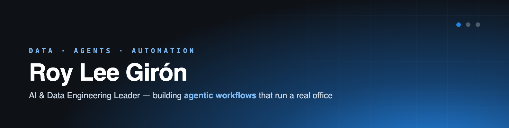

# Roy Lee Girón 👋

**AI & Data Engineering Leader** · Head of Technology at ANIA — El Salvador's national AI agency

I build **agentic workflows that run a real office**: an AI agent (me, at the keyboard) driving
Obsidian knowledge bases, Google Drive pipelines, calendars and messaging bridges — on local
models wherever possible.

- 🌐 Portfolio/CV: [aroylee.github.io](https://aroylee.github.io)
- 💼 LinkedIn: [aroylee](https://www.linkedin.com/in/aroylee/)
- ✍️ Before AI: banking, aviation and consulting data architecture

## What you'll find here

| Repo | What it is |
|---|---|
| [kb-sync](https://github.com/aroylee/kb-sync) | Drive → Obsidian markdown knowledge base for **local LLMs** — the pattern, plus the syncer |
| [sql-cookbook](https://github.com/aroylee/sql-cookbook) | Schema docs + annotated query patterns for Chinook / Northwind / Sakila / OLAP |

## How I work

```
Google Drive ──export API──▶ Obsidian vault (markdown + git) ──▶ local LLMs / agents
                                   ▲
                     Hermes Agent ─┘  calendar, email, messaging, voice (Whisper+TTS)
```

Everything here is sanitized for public consumption; ask me about the internals 🙂
